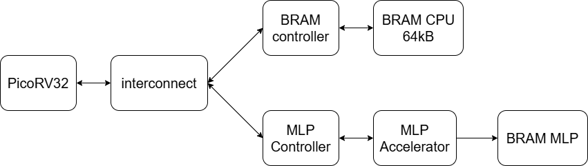
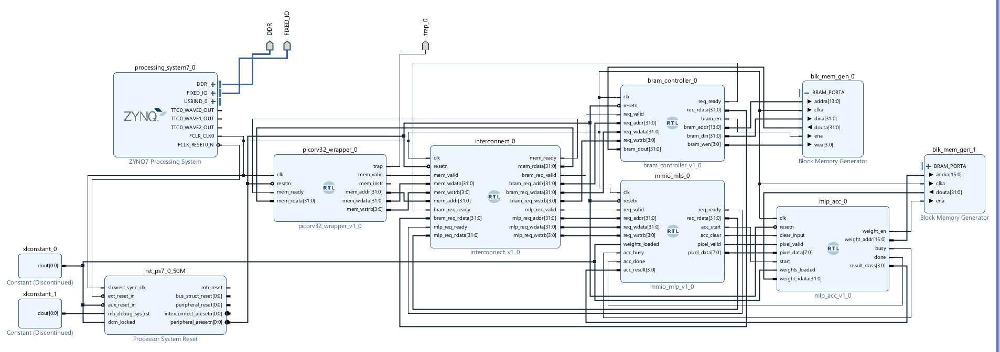

# PicoRV32 RISC-V SoC with Hardware MLP Accelerator

A compact, high-performance System-on-Chip (SoC) for real-time MNIST handwritten digit classification, implemented on a **Xilinx Zynq-7000 FPGA (xc7z020)** running at **100 MHz**.

The system pairs a 32-bit **PicoRV32 RISC-V** processor with a custom **pipelined Multi-Layer Perceptron (MLP) neural network accelerator**, integrated via a memory-mapped I/O (MMIO) bus interconnect.

---

## Architecture Overview



## Block design in Vivado



### Execution Flow
1. **Boot**: PicoRV32 boots bare-metal C firmware from CPU BRAM (`0x0000_0000`).
2. **Transfer**: CPU reads a 784-byte grayscale image ($28 \times 28$) from memory and streams it to the accelerator via MMIO.
3. **Inference**: Accelerator executes 2-layer fixed-point MLP inference using DSP48E1 slices and parallel MACs.
4. **Classification**: Hardware Argmax determines the predicted digit ($0 - 9$) and signals completion.
5. **Report**: CPU reads the result register and writes status to a completion mailbox (`0x2000`).

---

## Key Specifications

| Parameter | Specification |
|---|---|
| **Target Device** | Xilinx Zynq-7000 (`xc7z020clg484-1`) @ 100 MHz |
| **Timing Closure** | **MET** (Worst Negative Slack: **+0.108 ns**) |
| **CPU Core** | PicoRV32 (RV32I base integer instruction set) |
| **Network Topology** | $784 \text{ Inputs} \to 64 \text{ Hidden (ReLU)} \to 10 \text{ Outputs (Argmax)}$ |
| **Quantization** | Fixed-point Q15 weights, Q30/Q31 accumulators (no floating-point) |
| **DSP Utilization** | 4 $\times$ DSP48E1 slices (2 parallel MACs per layer) |
| **FPGA Resources** | Slice LUTs: **4.35%** (2,314 / 53,200), FFs: **1.22%** (1,301 / 106,400) |
| **Verification** | 100% bit-exact logits match with Python reference model |

---

## Memory Map

### 1. CPU Memory (64 KiB BRAM)
- `0x0000_0000 - 0x0000_0FFF`: Firmware instructions (`.text`, `.rodata`, `.data`, `.bss`)
- `0x0000_1000 - 0x0000_130F`: 784-byte raw image buffer
- `0x0000_2000`: `RESULT_MAILBOX` (Classified digit $0 - 9$)
- `0x0000_2004`: `DONE_MAILBOX` (`0x600D0001` = PASS)
- `0x0001_0000`: Initial Stack Pointer (`sp`)

### 2. Accelerator MMIO Registers (`Base: 0x1000_0000`)
- `+0x00` (`ADDR_CONTROL`): `bit[0]` = Start inference, `bit[1]` = Clear/Reset
- `+0x04` (`ADDR_STATUS`) : `bit[0]` = Busy, `bit[1]` = Done, `bit[2]` = Ready for pixel
- `+0x08` (`ADDR_PIXEL_DATA`): 8-bit unsigned pixel input ($0 - 255$)
- `+0x0C` (`ADDR_PIXEL_COUNT`): Number of received pixels ($0 - 784$)
- `+0x10` (`ADDR_RESULT`): Predicted class ($0 - 9$)

---

## Verification Results

| Testbench | Level | Purpose | Status |
|---|---|---|:---:|
| `tb/tb_case1_single_image.v` | Full SoC | Single image inference (Digit 3), verifies all 10 logits bit-for-bit | **PASS** |
| `tb/tb_case2_multi_image.v` | Full SoC | Back-to-back 3-image inference (Digits 3, 0, 7) | **PASS** |
| `tb/tb_case3_mmio_protocol.v` | Standalone | MMIO handshake, FIFO stress, and reset behavior | **PASS** |

---

## Repository Structure

```text
picorv32_mlp_soc/
├── rtl/            # Verilog RTL (PicoRV32, wrapper, interconnect, BRAM ctrl, MMIO, MLP)
├── tb/             # Testbenches (Case 1 single image, Case 2 multi image, Case 3 MMIO)
├── firmware/       # Bare-metal C & Assembly (start.S, main.c, linker.ld, build scripts)
├── model/          # Quantization script (mlp.py) and pre-trained weight COE/MEM files
├── data/images/    # Sample MNIST test images (PNG/JPG and raw 784-byte .bin)
├── docs/           # Verification logs, post-implementation report, and schematics
├── Makefile        # Build and simulation automation
└── README.md       # Project overview
```

---

## Execution Guide (End-to-End)

### Prerequisites
- **Vivado**: Xilinx **Vivado 2022.2** (Simulator `xsim`, Block Design / IP Integrator, Synthesis & Implementation)
- **Target FPGA**: Xilinx Zynq-7000 (`xc7z020clg484-1` / `xc7z020clg400-1`)
- **Firmware Toolchain (Ubuntu / WSL)**:
  ```bash
  sudo apt update && sudo apt install gcc-riscv64-unknown-elf binutils-riscv64-unknown-elf python3 python3-pil
  ```

### Step 1: Train & Quantize MLP Model
- Pre-trained notebook: [kaggle training model](https://www.kaggle.com/code/tdngvntin/training-mlp)
- `model/mlp.py` quantizes weights/biases into fixed-point Q15/Q30/Q31 and exports `model/mlp_bram_init.coe` (for Vivado Weight ROM) and golden reference logits.

### Step 2: Build RISC-V Firmware & Pack CPU BRAM
Compile `start.S` + `main.c` (`-march=rv32i -mabi=ilp32`) and pack the ELF + 784-byte image into a 64 KiB `.coe` / `.mem` / `.mif`:
```bash
cd firmware
# Single-image firmware (generates build/bram_cpu.coe)
bash build.sh ../data/images/img_106.jpg

# Or 3-image continuous firmware (generates build_multi3/bram_cpu_multi3.coe)
bash build_multi3.sh
```
*(Pre-compiled files are already available in `firmware/prebuilt/`.)*

### Step 3: Vivado 2022.2 Block Design Setup
1. Create a Vivado 2022.2 project targeting `xc7z020` and add all sources from `rtl/`.
2. In Block Design (`final_wrapper`), instantiate `processing_system7_0` (100 MHz `FCLK_CLK0`), `picorv32_wrapper`, `interconnect`, `bram_controller`, `mmio_mlp`, and `mlp_acc`.
3. Configure **Block Memory Generator**:
   - `blk_mem_gen_0` (CPU BRAM, 64 KiB, 1-cycle latency): Load `firmware/prebuilt/bram_cpu.coe`.
   - `blk_mem_gen_1` (Weight ROM, 50 KiB): Load `model/mlp_bram_init.coe`.

### Step 4: Run Verification Testbenches

The verification strategy progresses from **unit-level MMIO protocol** to **full-SoC end-to-end execution**:

1. **Test Case 3 — MMIO & Accelerator Protocol (`tb/tb_case3_mmio_protocol.v`)**
   - **Approach**: Standalone testbench directly driving `mmio_mlp` + `mlp_acc` (bypassing CPU/BRAM) to validate bus handshakes, 784-pixel streaming, `acc_clear` reset, `acc_start`, and `done` flags.
   - **Run**:
     ```bash
     make sim_case3
     ```
2. **Test Case 1 — Full SoC Single Image (`tb/tb_case1_single_image.v`)**
   - **Approach**: Simulates the full `final_wrapper_wrapper` Block Design. PicoRV32 boots from `blk_mem_gen_0` (`bram_cpu.coe`), streams 784 pixels to `mmio_mlp`, polls completion, and writes `RESULT_MAILBOX` (`0x2000`) & `DONE_MAILBOX` (`0x2004 = 0x600D0001`). The testbench compares all 10 hardware logits bit-for-bit against the Python golden model.
   - **Run**: Add `tb/tb_case1_single_image.v` as top simulation source in Vivado 2022.2 (with `final_wrapper_blk_mem_gen_0_0.mif` from `bram_cpu.coe`) and run Behavioral Simulation (`~1.56 ms` sim time).
3. **Test Case 2 — Full SoC Multi-Image (`tb/tb_case2_multi_image.v`)**
   - **Approach**: Loads `bram_cpu_multi3.coe` containing 3 consecutive images (`0x1000`, `0x1400`, `0x1800`) to verify back-to-back classification (`[3, 0, 7]`) and proper `acc_clear` state reset between runs (`~4.67 ms` sim time).
