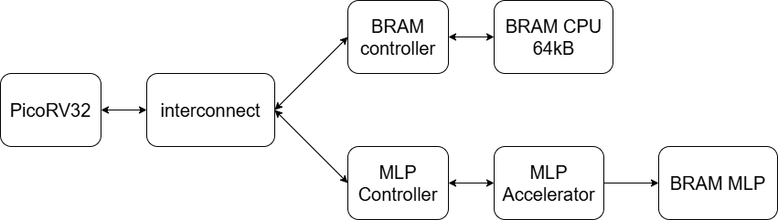

# PicoRV32 RISC-V SoC with Hardware MLP Accelerator

A compact, high-performance System-on-Chip (SoC) for real-time MNIST handwritten digit classification, implemented on a **Xilinx Zynq-7000 FPGA (xc7z020)** running at **100 MHz**.

The system pairs a 32-bit **PicoRV32 RISC-V** processor with a custom **pipelined Multi-Layer Perceptron (MLP) neural network accelerator**, integrated via a memory-mapped I/O (MMIO) bus interconnect.

---

## Architecture Overview



### Execution Flow
1. **Boot**: PicoRV32 boots bare-metal C firmware from CPU BRAM (`0x0000_0000`).
2. **Transfer**: CPU reads a 784-byte grayscale image ($28 \times 28$) from memory and streams it to the accelerator via MMIO.
3. **Inference**: Accelerator executes 2-layer fixed-point MLP inference using DSP48E1 slices and parallel MACs.
4. **Classification**: Hardware Argmax determines the predicted digit ($0 - 9$) and signals completion.
5. **Report**: CPU reads the result register and writes status to a completion mailbox (`0x2000`).

---

## Key Specifications

| Parameter | Specification |
|---|---|
| **Target Device** | Xilinx Zynq-7000 (`xc7z020clg484-1`) @ 100 MHz |
| **Timing Closure** | **MET** (Worst Negative Slack: **+0.108 ns**) |
| **CPU Core** | PicoRV32 (RV32I base integer instruction set) |
| **Network Topology** | $784 \text{ Inputs} \to 64 \text{ Hidden (ReLU)} \to 10 \text{ Outputs (Argmax)}$ |
| **Quantization** | Fixed-point Q15 weights, Q30/Q31 accumulators (no floating-point) |
| **DSP Utilization** | 4 $\times$ DSP48E1 slices (2 parallel MACs per layer) |
| **FPGA Resources** | Slice LUTs: **4.35%** (2,314 / 53,200), FFs: **1.22%** (1,301 / 106,400) |
| **Verification** | 100% bit-exact logits match with Python reference model |

---

## Memory Map

### 1. CPU Memory (64 KiB BRAM)
- `0x0000_0000 - 0x0000_0FFF`: Firmware instructions (`.text`, `.rodata`, `.data`, `.bss`)
- `0x0000_1000 - 0x0000_130F`: 784-byte raw image buffer
- `0x0000_2000`: `RESULT_MAILBOX` (Classified digit $0 - 9$)
- `0x0000_2004`: `DONE_MAILBOX` (`0x600D0001` = PASS)
- `0x0001_0000`: Initial Stack Pointer (`sp`)

### 2. Accelerator MMIO Registers (`Base: 0x1000_0000`)
- `+0x00` (`ADDR_CONTROL`): `bit[0]` = Start inference, `bit[1]` = Clear/Reset
- `+0x04` (`ADDR_STATUS`) : `bit[0]` = Busy, `bit[1]` = Done, `bit[2]` = Ready for pixel
- `+0x08` (`ADDR_PIXEL_DATA`): 8-bit unsigned pixel input ($0 - 255$)
- `+0x0C` (`ADDR_PIXEL_COUNT`): Number of received pixels ($0 - 784$)
- `+0x10` (`ADDR_RESULT`): Predicted class ($0 - 9$)

---

## Verification Results

| Testbench | Level | Purpose | Status |
|---|---|---|:---:|
| `tb/tb_case1_single_image.v` | Full SoC | Single image inference (Digit 3), verifies all 10 logits bit-for-bit | **PASS** |
| `tb/tb_case2_multi_image.v` | Full SoC | Back-to-back 3-image inference (Digits 3, 0, 7) | **PASS** |
| `tb/tb_case3_mmio_protocol.v` | Standalone | MMIO handshake, FIFO stress, and reset behavior | **PASS** |

---

## Repository Structure

```text
picorv32_mlp_soc/
├── rtl/            # Verilog RTL (PicoRV32, wrapper, interconnect, BRAM ctrl, MMIO, MLP)
├── tb/             # Testbenches (Case 1 single image, Case 2 multi image, Case 3 MMIO)
├── firmware/       # Bare-metal C & Assembly (start.S, main.c, linker.ld, build scripts)
├── model/          # Quantization script (mlp.py) and pre-trained weight COE/MEM files
├── data/images/    # Sample MNIST test images (PNG/JPG and raw 784-byte .bin)
├── docs/           # Verification logs, post-implementation report, and schematics
├── Makefile        # Build and simulation automation
└── README.md       # Project overview
```

---

## Quickstart

### 1. Build Firmware (Ubuntu / WSL)
Requires `gcc-riscv64-unknown-elf` or `gcc-riscv32-unknown-elf`:
```bash
cd firmware
bash build.sh ../data/images/img_106.jpg
```

### 2. Run Simulation (Vivado xsim)
```bash
# Run standalone MMIO & accelerator testbench
make sim_case3
```
